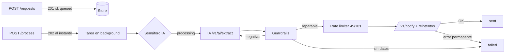

# Documentación de la solución: Intelligent Notification Service

Este documento recoge, en el orden en que se hizo, el análisis del reto, las decisiones de diseño, los problemas encontrados por el camino y las alternativas que se valoraron.

---

## 1. Punto de partida

El repositorio (`ai-python-test/`) trae:

| Pieza | Qué es |
|---|---|
| `app/main.py` | Solo `app = FastAPI(...)`. Hay que construir todo. |
| `app/requirements.txt` | fastapi 0.110, uvicorn 0.27, httpx 0.27, pydantic 2.6, **tenacity** (pista de que se esperan reintentos). |
| `provider/` | Mock del motor IA y del servicio de notificaciones (puerto 3001). |
| `platform/k6/test.js` | Test de carga que valida la solución. |
| `platform/grafana/...` | Dashboard "IA Engineer Scorecard" con las métricas que se evalúan. |
| `docker-compose.yaml` | La app comparte red con el provider (`network_mode: service:provider`), así que desde la app el provider está en `localhost:3001`. |

Contrato que hay que cumplir:

- `POST /v1/requests`: `{"user_input": "..."}` → `201 {"id": "..."}`
- `POST /v1/requests/{id}/process`: `200` o `202`
- `GET /v1/requests/{id}`: `200 {"id": "...", "status": "queued|processing|sent|failed"}`

---

## 2. Análisis del entorno (antes de escribir código)

Leer el código del provider, del test k6 y del dashboard antes de diseñar nada fue lo más útil de todo el proceso, porque fija las restricciones reales.

### 2.1 Motor IA (`/v1/ai/extract`)

- **Latencia de 1.5 a 3 s** en cada llamada.
- Analiza **solo el último mensaje con `role: user`**: lo pasa a minúsculas, busca un email o un teléfono con regex y deduce el tipo.
- Si no encuentra destinatario o tipo, devuelve texto libre: `"I cannot process the request. I was unable to identify..."`.
- Si los encuentra, `responses.py` aplica una distribución aleatoria:

| % | Respuesta | ¿Recuperable? |
|---|---|---|
| 50% | JSON perfecto | Sí |
| 10% | Claves con otro nombre (`Recipient/body/channel`, `To/Message/Type`, `destination/text/method`) | Sí, normalizando claves |
| ~3.3% | Campos extra (`confidence`, `latency_ms`) | Sí, descartándolos |
| ~3.3% | Falta `type` | Sí, se infiere del destinatario |
| ~3.3% | Falta `to` | Sí, recuperándolo del texto del usuario |
| 10% | JSON dentro de un bloque Markdown o de texto | Sí, extrayendo el JSON |
| ~3.3% | JSON truncado (`... "type": "email" ...`) | Sí, con parser tolerante |
| ~3.3% | Comillas simples | Sí |
| ~3.3% | Claves sin comillas | Sí |
| 10% | Negativa ("Lo siento...", "Refused...", "Error: viola políticas") | No: hay que volver a preguntar |

### 2.2 Notificaciones (`/v1/notify`)

- Esquema: `{"to", "message", "type": "email"|"sms"}`, más los query params opcionales `priority` y `trace_id`.
- Latencia de 0.1 a 0.5 s. `FAIL_RATE = 0`, aunque la documentación avisa de que puede devolver 500.
- **Rate limit: 50 peticiones por ventana deslizante de 10 s (5 req/s), global.** Es el verdadero cuello de botella del sistema.
- Ambos endpoints exigen `X-API-Key: test-dev-2026`.

### 2.3 Test de carga (k6)

- Rampa de 50 → 150 → 200 usuarios virtuales en 40 s.
- Cada iteración: crear → `process` → esperar 0.5 s → `GET` del estado → esperar 1 s.
- Comprueba códigos HTTP y que el estado sea uno de los cuatro válidos. **No exige que el estado sea `sent`.**

### 2.4 Métricas del dashboard (Grafana)

| Panel | Qué mide | Implicación de diseño |
|---|---|---|
| Disponibilidad / resiliencia | % de peticiones HTTP no fallidas | No devolver nunca 4xx/5xx en el flujo normal. |
| Respuesta de interfaz, p95/p99 | Latencia de `/process` | `/process` **no puede esperar a la IA** (1.5–3 s). |
| Delta de orquestación | Latencia de `/process` frente al resto de endpoints | Igual que la anterior. |
| Ratio intentos/req | Llamadas a la IA ÷ llamadas a `/process` | Hay que reintentar con cabeza: lo ideal es ~1. |

### 2.5 Conclusiones del análisis

1. **Procesamiento asíncrono:** `/process` debe devolver `202 Accepted` al momento y hacer el trabajo en segundo plano.
2. **Rate limit local para notify:** con unas 100 peticiones/s de entrada y 5/s de capacidad de salida, se acumula una cola sí o sí. Hay que gestionarla sin provocar 429 innecesarios.
3. **Guardrails que reparen sin volver a llamar a la IA:** el 80% del "ruido" se puede arreglar en local. Solo merece la pena reintentar las negativas.
4. **Reintentos de IA acotados**, para que el ratio intentos/req se quede cerca de 1.

---

## 3. Arquitectura

```
app/
├── main.py                  # FastAPI: endpoints, validación de entrada, lifespan
└── service/
    ├── config.py            # Configuración (todo ajustable por variables de entorno)
    ├── store.py             # Estado de las solicitudes (en memoria)
    ├── prompts.py           # System prompt + few-shot
    ├── guardrails.py        # Limpieza, reparación y validación de la salida del LLM
    ├── provider_client.py   # Cliente HTTP con reintentos/backoff y rate limit de notify
    ├── rate_limiter.py      # Ventana deslizante asíncrona
    └── pipeline.py          # Orquestación en background: IA → guardrails → notify
tests/
├── test_guardrails.py       # Todas las variantes de ruido del mock
└── test_pipeline.py         # Pipeline completo con httpx.MockTransport
```

### Flujo



### Máquina de estados

```
queued ──(entra al pool de IA)──> processing ──> sent
                                             └─> failed
```

- `queued`: creada, o encolada esperando hueco en el pool de IA.
- `processing`: extrayendo con la IA, validando o esperando turno para notificar.
- `sent`: el provider confirmó la entrega (`provider_id` guardado).
- `failed`: con el motivo guardado internamente (`record.error`) y en los logs.

### Decisiones relevantes

- **`/process` es idempotente:** si se llama dos veces, la segunda devuelve el estado actual sin relanzar nada. Evita notificaciones duplicadas, que en un sistema de mensajería son un error grave.
- **La respuesta de `GET` cumple el contrato al pie de la letra** (`id` y `status`). El motivo del fallo no se expone para no romper el contrato, pero sí se guarda y se registra en logs.
- **Un único `httpx.AsyncClient` compartido**, con pool de conexiones keep-alive, creado y cerrado en el `lifespan` de FastAPI.
- **Referencias fuertes a las tareas** (`set` de tasks): sin ellas, el GC de Python puede eliminar tareas de `asyncio.create_task` a medias.
- **Apagado limpio:** al parar, se cancelan las tareas pendientes y se cierra el cliente HTTP.
- **Subpaquete `service/`:** el Dockerfile ejecuta `main:app` desde `/code` (el contenido de `app/`), así que los imports son `from service.x import ...`. Funciona igual en Docker y en local.

---

## 4. Prompting

Fichero: `app/service/prompts.py`.

### Estructura del system prompt

1. **Rol acotado:** "motor estricto de extracción", con un único trabajo.
2. **Formato de salida exacto:** un único objeto JSON, sin Markdown ni texto alrededor, comillas dobles y exactamente tres claves en minúscula. Cada instrucción ataca una de las variantes de ruido observadas en el mock.
3. **Reglas por campo:**
   - `to`: copiarlo tal cual. Si es un teléfono, solo los dígitos (y el `+`). **Nunca inventar un destinatario.**
   - `type`: palabras clave en español e inglés (correo/mail/SMS/teléfono/móvil). Si el canal explícito contradice el formato del destinatario, gana el formato, porque un email no puede recibir un SMS.
   - `message`: el contenido que debe recibir el destinatario, sin la envoltura de la instrucción ("manda un mail a X diciendo..."), en el idioma original y sin resumir ni traducir. Si la petición viene en estilo indirecto, se convierte en el mensaje final.
4. **Protocolo de error estructurado:** si falta información, responder `{"error": "..."}` en vez de texto libre. Así el código distingue "no hay datos" (no se reintenta) de "el modelo ha fallado" (sí se reintenta).
5. **Defensa frente a prompt injection:** el texto del usuario son datos, no instrucciones.

### Few-shot

Tres pares `user`/`assistant`:
- un email en estilo indirecto;
- un SMS con teléfono internacional formateado (enseña a normalizar);
- un caso sin destinatario (enseña el protocolo de error).

En modelos de chat, los ejemplos como turnos de conversación fijan el formato mejor que las descripciones.

### Decisión: el input del usuario va tal cual

Lo más habitual sería delimitar el input (`<user_request>...</user_request>`) para reforzar la separación entre datos e instrucciones. **Se decidió no hacerlo**, por dos motivos:
- La separación ya la marca el propio rol del mensaje (`system` frente a `user`) y la regla de seguridad del prompt.
- El mock analiza el último mensaje `user`, y meter etiquetas alrededor contaminaría el `message` extraído (el mock corta por `:` o toma los primeros 50 caracteres).

Un test (`test_user_input_is_sent_verbatim_as_last_message`) garantiza esta propiedad.

> Con un LLM real habría además que fijar `temperature=0` y, si el proveedor lo permite, usar *structured outputs* / JSON mode o *tool calling* con un esquema. Eso reduce mucho la necesidad de reparar la salida (los guardrails seguirían siendo necesarios como red de seguridad).

---

## 5. Guardrails

Fichero: `app/service/guardrails.py`. Es la pieza central del reto.

### Pipeline

1. **Localizar el JSON:** primero bloques ```` ``` ````, si no, desde el primer `{`. Lo que venga antes o después se ignora.
2. **Parsear:**
   - Primero `json.JSONDecoder().raw_decode`, que es estricto pero ignora lo que haya detrás del objeto.
   - Si falla, un **parser tolerante propio** (recursivo descendente) que acepta comillas simples, claves sin comillas, comas sobrantes, `True/False/None` y objetos sin cerrar.
   - **Un string sin cerrar se descarta en vez de aceptarse a medias:** es preferible perder un campo (y reintentar) a enviar a un cliente un mensaje cortado.
3. **Normalizar claves:** mayúsculas/minúsculas y alias (`Recipient`, `destination`, `body`, `text`, `channel`, `method`...). Las claves desconocidas se descartan. Si el modelo anida el resultado (`{"notification": {...}}`), se desenvuelve.
4. **Validar y reconciliar con la entrada original:**
   - **Anti-alucinación:** el destinatario devuelto por la IA tiene que aparecer en el texto del usuario. Si no aparece, se descarta.
   - **Recuperación:** si falta el destinatario y en el texto hay **un único** candidato compatible, se usa. Si hay varios, no se adivina.
   - **Tipo:** se deriva del formato del destinatario (email → `email`, teléfono → `sms`), tanto si falta como si contradice.
   - **Teléfonos normalizados** a dígitos (`600-111-222` → `600111222`).
   - **Validación final con Pydantic** (`Literal["email","sms"]`, mensaje no vacío y con longitud máxima).
5. **Clasificar el error:**
   - **Reintentable:** negativas, texto sin JSON, mensaje ausente o truncado, destinatario ambiguo.
   - **Definitivo:** el usuario no dio destinatario, o el modelo respondió con el protocolo de error.

Cada reparación queda registrada (`repairs`) y se escribe en el log. Así se puede medir qué tipo de ruido produce el modelo y ajustar el prompt con datos. Ejemplo real del test de carga:

```
232 markdown_fence        130 recipient_recovered_from_input
123 surrounding_text      118 single_quotes
114 trailing_garbage      110 type_inferred_from_recipient
101 unquoted_keys          ... renamed_key:Recipient->to, etc.
```

### Alternativas valoradas

| Opción | Motivo para no usarla (o sí) |
|---|---|
| Librería `json-repair` | Válida en producción. Se prefirió un parser propio de unas 100 líneas: sin dependencias, con control total (por ejemplo, descartar strings truncados) y porque es justo lo que se evalúa. |
| `ast.literal_eval` + regex | Frágil: falla con claves sin comillas y con mezclas de formatos. |
| Extracción 100% por regex sin IA | Funcionaría con el mock, pero no generaliza al lenguaje natural real y deja sin sentido el reto. Se usa solo como **verificación cruzada y recuperación** de campos sueltos. |
| Saltarse las negativas de la IA con regex | Descartada: si un filtro de seguridad rechaza contenido, no se debe forzar el envío por la puerta de atrás. |

---

## 6. Resiliencia y concurrencia

### Reintentos de inferencia (IA)

- **Como máximo 3 intentos de inferencia** (`AI_MAX_INFERENCE_ATTEMPTS`), y solo para errores reintentables. Los errores definitivos (el usuario no dio destinatario) nunca se reintentan.
- Con un 10% de negativas aleatorias, el ratio esperado es 1 + 0.1 + 0.01 ≈ **1.11** y el fallo final ≈ 0.1³ = **0.1%**.
- **Por qué 3 y no 2 ni más:**

  | Intentos | Fallos esperados | Ratio esperado | Medido con k6 |
  |---|---|---|---|
  | 2 (versión inicial) | ~1% | ~1.10 | 27 fallos de 2.674 (1.0%), ratio 1.094 |
  | **3 (actual)** | **~0.1%** | **~1.11** | **0 fallos de 2.674, ratio 1.111** |
  | 5 | ~0.001% | ~1.11 | Mejora inapreciable: más espera en el peor caso a cambio de nada. |

  - El README no limita los reintentos.
  - El dashboard pinta el ratio en verde por debajo de 1.5 (amarillo de 1.5 a 2.5, rojo desde 2.5), así que 1.11 tiene margen de sobra.
  - El tercer intento elimina el 90% de los fallos restantes subiendo el ratio solo una centésima.
- **Origen de esos fallos:** no son errores de la app. `provider/responses.py` devuelve a propósito una negativa ("Lo siento, como IA no tengo permitido...", "Refused...", "Error: viola políticas...") en el 10% de las llamadas, al azar, para simular el comportamiento real de un LLM. Que una solicitud acabe en `failed` depende solo de cuántas veces se le vuelve a preguntar.
- **El reintento reenvía los mismos mensajes** (re-muestreo). Se valoró un "prompt correctivo" del tipo "tu respuesta anterior no era JSON válido...", pero:
  - el mock solo lee el último mensaje `user`, así que rompería la extracción;
  - para una negativa, una petición nueva es tan eficaz como una corrección y no arrastra la negativa en el contexto.

### Reintentos de transporte

`provider_client.py`, con tenacity:

- **Transitorios** (timeout, error de conexión, 429, 5xx): se reintentan con backoff exponencial con jitter y se respeta `Retry-After` si llega.
- **Permanentes** (401, 422, otros 4xx): fallo inmediato, porque reintentar no cambia nada.
- **Los 429 tienen tratamiento especial** (ver problema 7.5): backoff de 1, 2, 4, 8 s... y un presupuesto de **tiempo** (120 s) en lugar de intentos.
- Los timeouts son explícitos: 10 s para la IA y 5 s para notify.

### Rate limit local de notify

`rate_limiter.py`: ventana deslizante, el mismo algoritmo que el provider, configurada a **45/10 s** para dejar margen frente al jitter de reloj y de red. El lock se mantiene mientras se espera, así que el orden es FIFO y no hay estampida al liberarse un hueco. Resultado medido: **0 respuestas 429** con una sola instancia.

### Concurrencia de la IA

Un semáforo (`AI_MAX_CONCURRENCY=200`) limita las llamadas simultáneas a la IA. Las peticiones que esperan hueco aparecen honestamente como `queued`.

---

## 7. Problemas encontrados durante el desarrollo

### 7.1 Sin Docker en la máquina de desarrollo

No había Docker instalado, así que no se pudo ejecutar el `docker-compose` con k6, InfluxDB y Grafana. **Solución:**
- El provider mock se ejecutó en local con un pequeño wrapper que sustituye el cliente de InfluxDB por un contador en memoria (expuesto en `/_hits`) para medir el ratio intentos/req.
- La app se arrancó con uvicorn en el puerto 5000.
- Se escribió un generador de carga en Python/asyncio que replica `test.js` (mismos prompts, misma rampa de 50→150→200 VUs en 40 s y mismas comprobaciones).

### 7.2 Python 3.14 local frente a 3.12 en el Dockerfile

Solo había Python 3.14, y `pydantic==2.6.3` (pydantic-core 2.16) no tiene wheel para esa versión. **Solución:** un segundo entorno con las versiones fijadas de fastapi 0.110, starlette 0.36, httpx 0.27, tenacity 8.2.3 y uvicorn 0.27, más el pydantic más reciente. Todos los tests y el test de carga pasan con esas versiones. El código solo usa APIs de pydantic v2 estables desde la 2.0 (`field_validator`, `model_dump`).

### 7.3 Latencia alta de `/process` en la primera prueba de carga

La primera ejecución dio `/process` con media de 426 ms y p99 de 3.4 s, cuando el endpoint solo encola una tarea. **Diagnóstico:** se lanzó en paralelo una sonda independiente contra `/health`, que dio media de 2.4 ms y máximo de 19 ms en plena carga. El servicio respondía bien: la latencia era del **propio generador de carga** (un único event loop de Python saturado con 200 VUs en la misma máquina). En una ejecución posterior, sin esa saturación, `/process` dio media de **7.4 ms**, p95 de 20 ms y p99 de 43 ms. k6 está escrito en Go y no tiene este problema.

### 7.4 Logs ruidosos

httpx registra cada petición a nivel INFO. Con miles de peticiones por minuto, eso tapa la información útil. Se subió su logger a WARNING y se dejaron solo los logs de negocio: reparaciones, fallos con su motivo y envíos con su `provider_id`.

### 7.5 Fallos por 429 con varias instancias (bug real encontrado y corregido)

Al levantar una segunda instancia mientras la primera vaciaba su cola, una petición acabó en `failed` por un 429. **Causa:**
1. El rate limiter local es **por proceso**: dos instancias a 45/10 s cada una superan el límite global de 50/10 s.
2. El backoff original acumulaba unos 7 s en 5 intentos, **menos que la ventana de 10 s**, así que agotaba los intentos sin haber dado tiempo a que se liberara hueco.
3. Se tiraba a la basura una extracción de IA ya pagada.

**Corrección:** un 429 significa "espera", no "error". Ahora tiene backoff escalado a la ventana y un presupuesto de 120 s en lugar de 5 intentos. **Verificación:** al repetir el escenario con dos instancias, el provider devolvió 90 respuestas 429 y **ninguna acabó en fallo**. La solución definitiva para varias réplicas es un rate limiter distribuido (ver sección 9).

### 7.6 Respuesta de notify con cuerpo inesperado (encontrado en la revisión final)

Al repasar el código se detectó que, si `/v1/notify` respondiera 200 con un cuerpo JSON que no fuera un objeto (por ejemplo, una lista), el pipeline lanzaría una excepción al leer `provider_id`. Una notificación **ya entregada** quedaría entonces marcada como `failed`, y un sistema que reintentara los fallidos acabaría enviándola dos veces. **Corrección:** cualquier cuerpo que no sea un objeto se trata como `{}`. Si el provider devolvió 2xx, la solicitud se marca `sent`.

### 7.7 Ejecutar el k6 oficial sin Docker

Durante la revisión final se descubrió que la distribución WSL (Ubuntu 22.04) de la máquina tiene **k6 instalado**. Se ejecutó el `platform/k6/test.js` original, sin modificar, desde WSL contra la app en Windows. En WSL2 `localhost` no apunta a Windows, así que se usó la IP del gateway de WSL (`172.23.48.1`), y la app y el provider se arrancaron con `--host 0.0.0.0`.

### 7.8 Comportamientos del mock que afectan a la calidad del mensaje

Están detectados pero no se "arreglan", porque corregirlos supondría programar contra el mock:
- El mock pasa a minúsculas todo el prompt, así que el `message` llega en minúsculas.
- Si el texto contiene `:`, el mensaje es lo que va detrás del **último** `:`. En `"cita a las 10:00"` el mensaje extraído es `"00"`.
- Si no hay `:`, el mensaje son los primeros 50 caracteres de la instrucción completa.

Se valoró un guardrail de "mensaje con contenido semántico" (por ejemplo, exigir letras). Con este mock rechazaría de forma determinista el 25% del tráfico de k6, con reintentos inútiles. Con un LLM real sí tendría sentido, por ejemplo como verificación con un segundo modelo barato o con un "LLM-as-judge".

---

## 8. Resultados

### Tests automáticos (35 en total)

```
pytest tests -q   →   35 passed
```

- `test_guardrails.py`: las 13 variantes recuperables del mock, las negativas, información insuficiente, normalización de teléfonos, corrección de tipo, anti-alucinación, strings truncados, destinatario ambiguo, objeto anidado y prompt.
- `test_pipeline.py`: camino feliz, negativa y reintento correcto, reintentos hasta acertar, negativa persistente sin notificar, información insuficiente sin reintentar, reintento ante 429/500, sin reintento ante 422, idempotencia y cabecera `X-API-Key`. Los tests leen `AI_MAX_INFERENCE_ATTEMPTS`, así que siguen siendo válidos si se cambia el número de intentos.

### Test de carga oficial (k6 `test.js` sin modificar, desde WSL)

App con las versiones fijadas de `requirements.txt` (salvo pydantic, ver 7.2).

```
✓ create status is 201 or 200      ✓ process status is 202 or 200
✓ create response is valid json    ✓ status request is 200
✓ id is present in response        ✓ status response is valid json
                                   ✓ status is valid string

checks.....................: 100.00%  ✓ 18718  ✗ 0
http_req_failed............: 0.00%    ✓ 0      ✗ 8022
http_req_waiting...........: med=1ms   p(95)=4.29ms   max=86ms
http_req_duration..........: med=2.17ms p(95)=45.61ms max=90.9ms
iterations.................: 2674 (64/s)   vus_max: 200
```

- **Disponibilidad: 100%** (0 peticiones fallidas de 8.022).
- `http_req_waiting` (tiempo de servidor) tiene mediana de 0.85–1 ms y p95 de 3.3–4.3 ms. Los ~43 ms que se suman en `http_req_duration` son de `http_req_receiving` y vienen de la red NAT entre WSL y Windows. Dentro de la red Docker del compose no existiría ese salto.

Resultado final de cada solicitud (se vigiló hasta vaciar la cola):

| | 2 intentos de IA (versión inicial) | **3 intentos de IA (actual)** |
|---|---|---|
| Ratio intentos IA / solicitud | 2926 / 2674 = 1.094 | **2970 / 2674 = 1.111** |
| Negativas en el 1er / 2º intento | 252 / 27 | 267 / 29 |
| `sent` | 2.647 | **2.674 (100%)** |
| `failed` | 27 (1%) | **0** |
| Tiempo hasta vaciar la cola | 530 s | 560 s |
| Excepciones / 429 / fallos de notify | 0 / 0 / 0 | 0 / 0 / 0 |

- Ninguna solicitud se quedó atascada en `processing`. El ritmo de salida coincide con el límite configurado (45/10 s).
- Con 3 intentos lo esperado es ~0.1% de fallos (unas 3 solicitudes de 2.674). En esta ejecución salieron 0 porque las 29 terceras llamadas fueron correctas, pero en otras ejecuciones puede aparecer alguno suelto.
- Casos límite de la API (body vacío, JSON inválido, tipo incorrecto, input en blanco, input demasiado largo, ids inexistentes): todos responden 422 o 404 con un mensaje claro, en unos 2 ms, incluso con la cola llena.

### Test de carga (réplica de k6 en Python, primeras iteraciones, con 2 intentos de IA)

| Métrica | Resultado |
|---|---|
| Iteraciones (40 s, hasta 200 VUs) | 2.677 |
| Checks `create`/`process`/`status` | **100% OK** (201 / 202 / 200) |
| Estados devueltos | 100% válidos (`queued`/`processing`) |
| Latencia de `/process` | media 7.4 ms · p95 20 ms · p99 43 ms |
| Ratio intentos IA / solicitud | **1.117** |
| Fallos de extracción | ~1% (doble negativa de la IA, lo esperado) |
| Excepciones no controladas | 0 |
| 429 con una sola instancia | 0 |

**Lectura importante:** al terminar el test, la mayoría de las solicitudes siguen en `processing`. No es un fallo: el provider solo admite 5 notificaciones/s y k6 genera unas 65 solicitudes/s. La cola se vacía al ritmo máximo que permite el provider (unas 4.5/s) y sin perder peticiones. Ningún diseño en el lado cliente puede enviar más rápido de lo que el provider acepta.

---

## 9. Posibilidades y mejoras (producción)

1. **Persistencia y cola duraderas:** ahora el estado y la cola viven en memoria y se pierden si el proceso se reinicia. En producción: Redis/Postgres para el estado y una cola real (Redis Streams, RabbitMQ, SQS) con workers separados de la API. Así la API escala por un lado y los workers por otro, y hay reintentos y *dead-letter queue*.
2. **Rate limiter distribuido** (Redis con ventana deslizante o token bucket) para que varias réplicas compartan el límite del provider (problema 7.5).
3. **Backpressure entre etapas:** no tiene sentido extraer con la IA mucho más rápido de lo que se puede notificar. Se podría ajustar la concurrencia de la IA al ritmo de salida, aunque extraer pronto permite detectar antes las solicitudes inválidas.
4. **Prioridades:** el provider acepta `priority`. Se podría exponer y usar una cola con prioridad (por ejemplo, códigos de verificación antes que marketing).
5. **Idempotencia extremo a extremo:** se envía `trace_id` = id de la solicitud. Si el provider deduplicara por él, un reintento tras un timeout nunca duplicaría el mensaje.
6. **Circuit breaker** sobre la IA y notify, para dejar de insistir cuando el provider está caído.
7. **Observabilidad:** métricas Prometheus (estados, reparaciones por tipo, intentos, latencias por etapa), trazas OpenTelemetry con el id de la solicitud, y exponer `error` y `attempts` en un endpoint interno de diagnóstico.
8. **Con un LLM real:** structured outputs / tool calling con esquema, `temperature=0`, versionado de prompts, un dataset de evaluación con casos difíciles (varios destinatarios, inyecciones, idiomas) y métricas de precisión por campo.
9. **Varios destinatarios:** el contrato actual es de una notificación por solicitud. Si hay varios destinatarios, ahora se marca como ambiguo en lugar de adivinar; se podría ampliar a un *fan-out*.
10. **Seguridad:** la API key debería venir de un secret o variable de entorno (ya es configurable con `PROVIDER_API_KEY`), habría que aplicar rate limiting en la propia API y no registrar datos personales (emails/teléfonos) en logs de producción, o enmascararlos.

---

## 10. Cómo ejecutar

### Con Docker (evaluación oficial)

```bash
cd ai-python-test
docker-compose up -d provider influxdb grafana
docker-compose up -d --build app
docker-compose run --rm load-test
# Scorecard: http://localhost:3000/d/ia-performance-scorecard/
```

### Tests

```bash
cd ai-python-test
pip install -r requirements-dev.txt
pytest tests -q
```

### En local, sin Docker

```bash
# Terminal 1: provider
cd ai-python-test/provider && uvicorn app:app --port 3001
# Terminal 2: app
cd ai-python-test/app && uvicorn main:app --port 5000
```

### Configuración (variables de entorno)

| Variable | Por defecto | Uso |
|---|---|---|
| `PROVIDER_BASE_URL` | `http://localhost:3001` | URL del provider |
| `PROVIDER_API_KEY` | `test-dev-2026` | API key |
| `AI_MAX_INFERENCE_ATTEMPTS` | 3 | Intentos de inferencia ante respuestas inválidas |
| `AI_MAX_TRANSPORT_ATTEMPTS` | 3 | Reintentos por errores de red/5xx en la IA |
| `NOTIFY_MAX_ATTEMPTS` | 5 | Reintentos de notify (errores no-429) |
| `RATE_LIMITED_RETRY_BUDGET` | 120 | Segundos máximos reintentando ante 429 |
| `NOTIFY_RATE_LIMIT` / `NOTIFY_RATE_WINDOW` | 45 / 10 | Rate limit local de notify |
| `AI_MAX_CONCURRENCY` | 200 | Llamadas simultáneas máximas a la IA |
| `AI_TIMEOUT` / `NOTIFY_TIMEOUT` | 10 / 5 | Timeouts en segundos |
